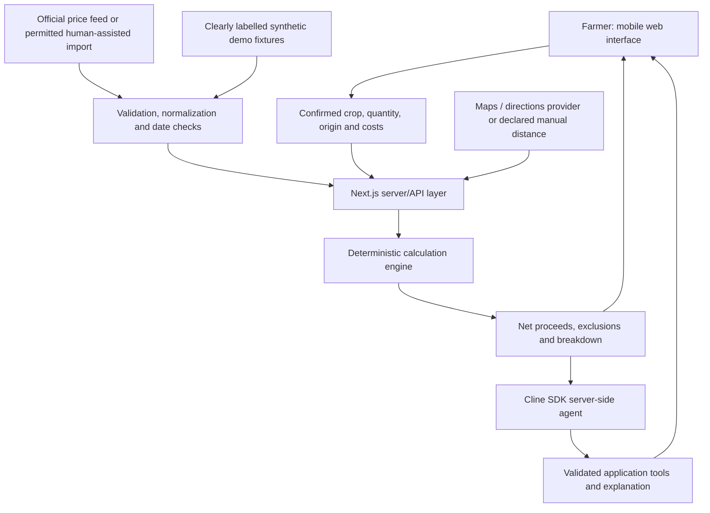

# 🌾 MandiNet

### Better mandi decisions, based on what the farmer takes home.

**Team ClineCoder** · **Cline AI Builder Hackathon 2026** · **IIT Guwahati**

> **A higher mandi price does not always mean higher earnings.** MandiNet compares *estimated net sale proceeds* across supported agricultural markets, taking transport costs, quantity, market expenses, and data freshness into account.

**Project status:** Working hackathon prototype under active development. The offline comparison flow and deterministic calculator are implemented and locally tested. Live government-record coverage, real Google Maps routing, and a live Cline model-provider session are **not yet verified**. See [Current implementation status](#current-implementation-status).

<!-- Add verified screenshots and demo links here when ready. Do not link to nonexistent assets. -->

## The problem

Farmers are often presented with a simple but misleading decision: sell at the mandi displaying the highest price. The actual amount they can take home also depends on:

- Distance to the market and the cost of reaching it.
- Crop quantity, tractor payload, and number of journeys required.
- Diesel, driver, hired-vehicle, and farmer-borne selling expenses.
- Whether the reported price corresponds to the **same crop and variety**.
- **When** that price was observed—not merely when a website was refreshed.
- Whether the destination and route are genuinely available.

A market offering ₹50 more per quintal might still leave the farmer with less money after transporting a full load. Most farmers should not need spreadsheets or technical knowledge to compare these trade-offs.

## Our solution

**MandiNet** is a mobile-first, multilingual decision-support website. The farmer selects a crop, quantity, origin, and transport assumptions. The app compares eligible mandi observations, calculates a transparent estimate of money remaining after costs, and explains why the highest quoted price might not be the best option.

The experience is designed to work for farmers who are unfamiliar with complex apps: simple input steps, clear money breakdowns, localized copy, and useful explanations even if the AI service is unavailable.

**The product makes an estimate—not a sale-price, profit, buyer-availability, or journey guarantee.** Reported mandi *modal* price is not an arithmetic average, and reported *minimum* price is not a confirmed low-quality crop offer.

## Features

| Capability | What it does |
| --- | --- |
| **Net-proceeds comparison** | Compares estimated money remaining after modeled transport and farmer-borne selling costs. |
| **Crop and quantity inputs** | Uses confirmed crop/variety and normalized units such as kg and quintals. |
| **Transport calculator** | Handles load counts and configurable owned-tractor or hired-vehicle assumptions. |
| **Price scenarios** | Separately models reported modal and minimum prices without treating them as guaranteed sale offers. |
| **Freshness and provenance** | Distinguishes price observation date, fetch time, record source, and data mode; stale records are excluded from the default recommendation. |
| **Location controls** | Supports location confirmation, village search, GPS accuracy awareness, and Change/Forget actions. A remembered selection uses a Place ID rather than storing raw GPS coordinates as a default preference. |
| **Market directions** | Provides a routing/directions integration path and fallback behavior when live road routing cannot be completed. |
| **Multilingual experience** | English, Hindi, and Gujarati interfaces and localized explanation fallbacks. |
| **AI explanation workflow** | A server-side Cline SDK integration is designed to explain *calculated* results, never invent or independently calculate financial amounts. |
| **Farmer-friendly fallback** | Financial comparison stays available when the model credentials or explanation service are missing. |

Availability of individual live integrations depends on credentials and verified data. The table describes the prototype's functionality and integration paths, **not** proof that every external provider has succeeded in production.

## How it works

1. **Choose your language and crop.** Select the exact crop and variety and enter the sellable quantity.
2. **Set your origin.** Confirm a searched place or grant location permission; review accuracy before continuing.
3. **Enter transport details.** Specify usable payload, owned or hired vehicle costs, and any applicable expenses.
4. **Compare supported mandis.** The system validates candidate observations, their dates, and available routes or explicitly entered distances.
5. **See the breakdown.** Review gross revenue, estimated transport, selling expenses, and **net sale proceeds** for each eligible option.
6. **Understand the reason.** Use a localized explanation and inspect excluded/stale records. Open directions where a verified destination is available.

### Example: the closer market can win

> **Demonstration only.** The following figures are deliberately **synthetic**, not live Agmarknet prices or a real transport quote.

Assume a farmer has **20 quintals (2,000 kg)**, a usable payload of **1,500 kg** (so **2 loads**), hired transport priced at **₹20 per round-trip vehicle-kilometre per load** (including fuel and driver), and **₹400** of total farmer-borne selling expenses per market.

| | Market A | Market B | Market C |
| --- | ---: | ---: | ---: |
| Reported observation date | 10 Oct 2026 | 10 Oct 2026 | 3 Oct 2026 |
| One-way distance | 10 km | 35 km | 20 km |
| **Illustrative modal price / quintal** | ₹2,200 | ₹2,250 | ₹2,400 |
| Gross proceeds | ₹44,000 | ₹45,000 | Not ranked |
| Transport expense | ₹800 | ₹2,800 | Not ranked |
| Selling expenses | ₹400 | ₹400 | Not ranked |
| **Estimated net proceeds** | **₹42,800** | **₹41,800** | **Excluded: stale** |

**Market A leaves ₹1,000 more than Market B**, even though B offers a higher headline price. Market C is excluded under this *demonstration's two-calendar-day freshness policy*; this policy is a product choice, not an official definition of a fresh market price.

## Architecture

MandiNet follows a small, understandable **Next.js + TypeScript** design: the interface collects confirmed inputs, server logic validates observations and transport inputs, and a **deterministic calculator** produces authoritative financial results. The AI layer describes those results rather than inventing new ones.



**Design principle:** the structured result, source ID, observation date, and calculator are authoritative. An LLM cannot override a route distance, record date, price, or computed amount. Synthetic records must never appear as live official records.

### Technology stack

| Layer | Technology / approach |
| --- | --- |
| Frontend | Next.js, React, TypeScript, mobile-first responsive UI |
| Server | Next.js server routes and TypeScript domain modules |
| Validation | Schema-validated inputs (Zod in the project design) |
| Calculation | Pure deterministic TypeScript functions |
| Market records | AGMARKNET / government dated observations or permitted imports, with separate synthetic fixtures |
| Location and routing | Place search / GPS confirmation; Google Maps Places/Routes integration where configured |
| AI integration | [`@cline/sdk`](https://docs.cline.bot/sdk/overview), server-side custom tool workflow |
| Languages | English, Hindi, Gujarati |
| Testing | Domain/integration checks, mock-model SDK smoke tests, typechecking and production build |

> **Note for contributors:** This README was prepared from the project build notes and hackathon plan, not by inspecting the complete source tree. Align specific file paths and npm script names below with the repository before publishing.

### Financial model

The comparison is **net sale proceeds**, not farm profit. Production expenses are not subtracted in the core calculation.

```text
quantityQuintals = quantityKg / 100
loads = ceil(quantityKg / usablePayloadKg)
grossProceeds = quantityQuintals * reportedPricePerQuintal
sellingExpenses = fixedFarmerExpenses
                + quantityQuintals * perQuintalExpenses
                + grossProceeds * (percentageExpense / 100)
netSaleProceeds = grossProceeds - transportCost - sellingExpenses
```

For an owned tractor, the modeled fuel estimate uses the loaded and empty return legs of **each load**:

```text
fuelLitres = loads * (outboundKm / loadedKmPerLitre
                    + returnKm / emptyKmPerLitre)
fuelCost = fuelLitres * dieselPricePerLitre
transportCost = fuelCost + driverCost + tolls + otherTransportCost
```

For hired transport, a fixed quote, whole-job quote, or per-kilometre quote is handled according to its stated terms. **Fuel and driver costs must not be added a second time when included in the quote.** Missing inputs remain incomplete rather than silently being treated as zero.

## Why Cline?

We used **Cline as the AI coding partner during development** and integrated the **Cline SDK into the application architecture** to support context-aware explanations grounded in application tools.

### Cline during development

Cline was used in an iterative workflow to help structure the application, implement the farmer interface and domain logic, connect adapters, integrate an SDK workflow, and run/fix local checks. The development record is documented in `BUILD_LOG.md` in the project repository.

### Cline inside MandiNet

The intended server-side flow gives the agent access only to bounded, validated application capabilities:

- Resolve or confirm crop, variety, quantity, and units.
- Retrieve dated price observations and applicable exclusion reasons.
- Retrieve available route estimates or declared manual distances.
- Request the deterministic sale-scenario calculator and explain its output in the chosen language.

These are **MandiNet application responsibilities**, not claims about built-in Cline SDK tool names. No open-ended filesystem/shell access is required by the runtime explanation feature. Numeric output comes from the calculator, not model-generated arithmetic.

**Verified SDK level:** application-tool invocation passed **mock-model smoke tests with labelled synthetic observations**. An actual provider-backed agent run has **not yet been verified**, because required Cline configuration is missing. If the SDK cannot run, the interface shows a deterministic, localized summary rather than pretending that AI executed.

## Data sources and integrity

Primary intended market-price source:

- [AGMARKNET — Daily Price and Arrival Report](https://www.agmarknet.gov.in/daily-price-and-arrival-report)
- [Government agricultural market price dataset](https://www.data.gov.in/resource/current-daily-price-various-commodities-various-markets-mandi)

Supporting documentation:

- [Cline SDK documentation](https://docs.cline.bot/sdk/overview)
- [Google Routes documentation](https://developers.google.com/maps/documentation/routes/compute-route-matrix)

MandiNet distinguishes **observation date** from **retrieval time**. It preserves the source, crop/variety, reported price unit, and acquisition mode (live fetch, cached official data, manual official import, or synthetic demo). Invalid or stale records are not silently allowed to win. Records downloaded after completing a CAPTCHA must be imported through a permitted human-assisted workflow; **the project does not depend on bypassing CAPTCHA**.

**Important:** A displayed government wholesale modal/minimum price is not a binding offer to buy the farmer's crop. Real sale proceeds depend on grade, local demand, fees, availability, and negotiated transaction terms.

## Run locally

### Requirements

- **Node.js 22+**, as required by the SDK integration plan.
- npm (or the package manager specified by the checked-in lockfile).
- Optional provider credentials for live maps and AI explanations.

### 1. Clone and install

```bash
git clone <YOUR_PUBLIC_REPOSITORY_URL>
cd <YOUR_PROJECT_DIRECTORY>
npm install
```

Replace the two placeholders with your actual GitHub URL and repository folder. If the repository uses a different package manager, follow its lockfile.

### 2. Configure optional integrations

Create a local `.env.local` file in the project root and set the relevant values:

```dotenv
# Cline-backed AI explanation (all three required for live provider testing)
CLINE_PROVIDER_ID=
CLINE_MODEL_ID=
CLINE_PROVIDER_API_KEY=

# Google Maps-backed place/route services
GOOGLE_MAPS_API_KEY=
```

Do **not** commit `.env.local`, API keys, personal coordinates, or downloaded private data. The calculator and labelled demo fallback do not require provider keys, but live routing and AI explanations do.

### 3. Start the app

```bash
npm run dev
```

Open the local address printed by the development server (commonly `http://localhost:3000`). This is the **standard Next.js command**; confirm it exists in your repository's `package.json` scripts before publishing.

### 4. Check the build

```bash
npm run build
```

Run the repository's defined test and typecheck scripts using the actual names listed in `package.json` (these names were not available in the attached materials). Do not infer the test script name from this README.

## Current implementation status

Snapshot from the local build report on **10 October 2026**:

| Area | Status |
| --- | --- |
| Deterministic calculations and demo amounts | Implemented; local tests passed |
| Crop/quantity comparison and stale-data exclusion | Implemented in the prototype |
| Village search and origin confirmation | Implemented; live village search not yet verified |
| GPS accuracy handling, Change/Forget, Place-ID-based remembering | Implemented |
| Calculator routing and encoded directions links | Wired; **live road routes not yet verified** |
| Verified live mandi destinations | **0 confirmed** at this checkpoint |
| Cline SDK tool calls | Passed **mock-model** smoke tests, not real-provider calls |
| Missing Cline config | `CLINE_PROVIDER_ID`, `CLINE_MODEL_ID`, `CLINE_PROVIDER_API_KEY` |
| Missing Maps config | `GOOGLE_MAPS_API_KEY` |
| Browser/UX checks | Included state invalidation, localized fallback and 360px layout |
| Test suite | **178 tests passed** in the reported local run |
| Typecheck and production build | Passed in the reported local run |
| Dependency audit | **34 vulnerabilities** reported, including **14 high** and **4 critical** |
| Public deployment | **Not cleared** pending security fixes and provider verification |

Latest reported local code checkpoint: commit **`f394f98`** on branch **`cline/w92fjemn`**. No Git remote had been configured at that checkpoint, so this README does not claim a published repository, live website, or recorded public demo.

### Current limitations

1. Real government-price coverage and destination identity must be verified against source records and location directories before a real-world recommendation is made.
2. Google Maps routing cannot be called without a configured key, billing/access where applicable, and verified mandi destinations. Driving directions alone do not guarantee a tractor-safe or legal route.
3. No successful live Cline SDK provider session has been established. Mock-model success demonstrates integration behavior but does not establish real provider availability.
4. Price reports are historical wholesale references; farmers must confirm present-day buying conditions and their actual transport quote.
5. The recorded dependency vulnerabilities require triage and remediation **before public deployment**.
6. Additional regions, crops, local measurements, and accessibility testing remain future work.

## Demo and evaluation

The intended demo demonstrates one farmer's journey from crop and quantity to ranked **estimated net proceeds**, the reason a nearer market can win, stale-record exclusions, and an AI/localized explanation. The example above is reproducible with synthetic fixtures. Live official data or external API success should be shown only when independently verified.

**Submission assets to attach when ready:**

- Product screenshots: add verified paths under `docs/screenshots/` (or the location actually used).
- Demo video: add the final public URL after upload.
- Presentation: add the final PPT link/path after it is committed.
- Development evidence: see `BUILD_LOG.md` for commands actually run, fixes, and Cline activity.

The hackathon submission calls for a public GitHub repo with README, a PPT, and a **mandatory demo video** showing the working product and Cline in action during development.

## Roadmap

- [x] Build the deterministic net-proceeds engine and synthetic comparison flow.
- [x] Build mobile-first farmer inputs and localized fallback explanations.
- [x] Wire origin selection, transport calculation, routes and Cline SDK application-tool integration.
- [ ] Verify official observations, crop/variety matching, and actual mandi destinations.
- [ ] Test Google Maps route requests for the chosen markets.
- [ ] Validate a live, provider-backed Cline SDK session and record real tool events.
- [ ] Resolve critical/high dependencies and complete security checks before any public deployment.
- [ ] Test end-to-end with real farmers and their transport/fee inputs.
- [ ] Extend coverage to more verified crops, districts, languages, and optional speech support.

## Team

**ClineCoder** — Cline AI Builder Hackathon, IIT Guwahati, 10 October 2026.

Built around one principle: **help farmers make clearer, more transparent market decisions without requiring technical expertise.**

---

*Disclaimer: MandiNet is a decision-support prototype. Price observations, routes, costs and example amounts can be stale, incomplete or illustrative. The application does not guarantee income, crop acceptance, buyer availability, or market access.*
